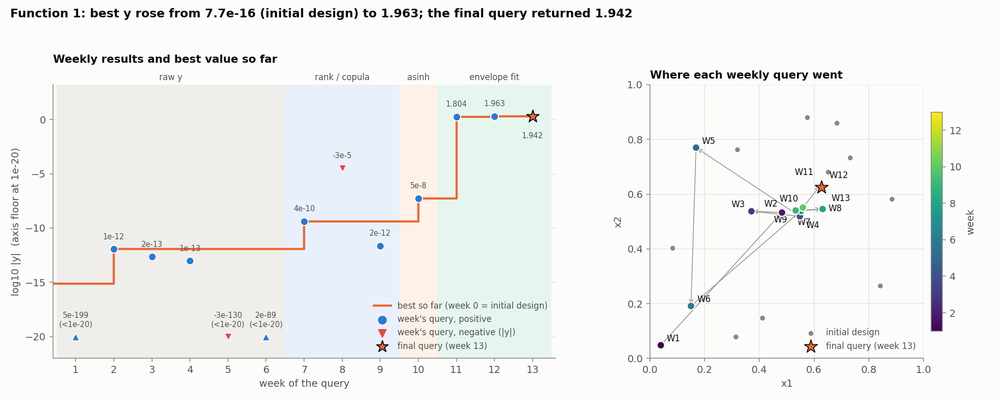
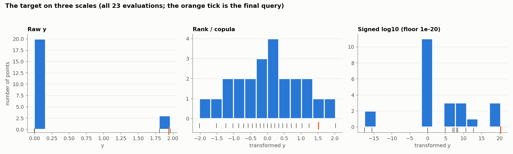
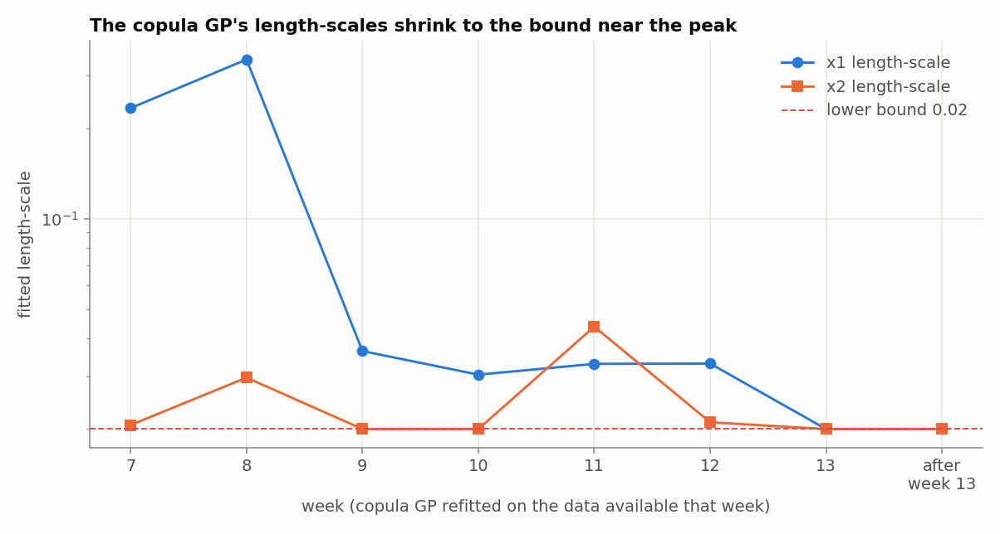
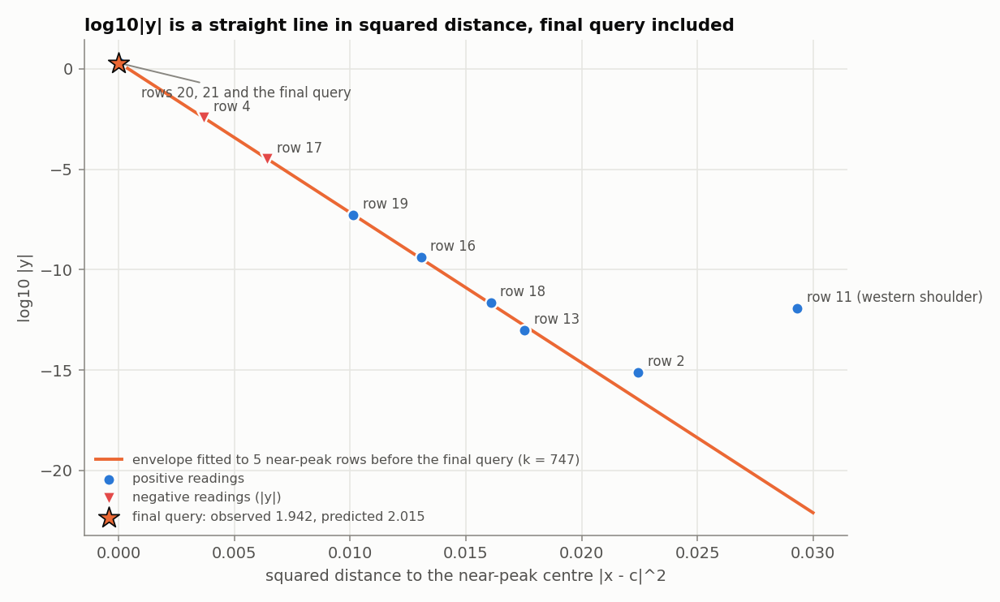

# Function 1: How the strategy evolved

Black-box optimisation, Function 1 (2 inputs in [0, 1], maximise). The report covers the strategy each week, the target transformations used after week 6 and why they changed, and why a Gaussian envelope was fitted. Facts (numbers, queries, outputs) come from the weekly notebooks and data. Weeks 7 to 13 are reproducible (seed 42). Weeks 1 to 6 are not.

The week-13 query is the suggested by the model near-peak centre, (0.626597, 0.625618). Its result, 1.94173290, comes from the final query.

## Progress through the rounds

*Figure 1. Left: each weekly result (log10 of the magnitude; red triangles are negative readings, values under 1e-20 sit on the axis floor) and the best value so far. Shading is the modelling regime. Right: where the queries went. The star is the final query.*

The best value rose in five steps: 7.7e-16 (initial design), 1.2e-12 (week 2), 4.2e-10 (week 7), 5.4e-8 (week 10), 1.804 (week 11) and 1.963 (week 12). The final query returned 1.942, so the final best stays **1.9634**. Weeks 1 to 10 gained about eight orders of magnitude together. Week 11 gained seven more in one step.

## 1. Timeline

The function is zero almost everywhere: the 10 initial points range from 5e-199 to 7.7e-16 in magnitude (about 196 orders of magnitude), and the only sizeable reading, -3.6e-3, is negative.

| Week | Target and surrogate | Acquisition | Query | Result |
|---|---|---|---|---|
| 1 to 6 | raw y; RBF, then isotropic Matérn GP [1]; no seed | UCB [2], LCB, EI [3] (settings varied by hand) | wandering; weeks 2 to 4 near the centre | 5.2e-199, 1.2e-12, 2.2e-13, 9.5e-14, -2.6e-130, 1.6e-89 |
| 7 | rank/copula [4]; ARD Matérn 5/2 | EI, xi 0.01 | (0.5521, 0.5390) | 4.2e-10 |
| 8 | same | EI | (0.6310, 0.5456) | **-3.3e-5** |
| 9 | same | EI | (0.5327, 0.5404) | 2.4e-12 |
| 10 | asinh(y/s) trial | EI on a grid | (0.5590, 0.5510) | 5.4e-8 |
| 11 | signed log10 GP + **envelope** | envelope centre | (0.6237, 0.6329) | **1.804** |
| 12 | envelope refits | mean of two centres | (0.6261, 0.6298) | **1.963** |
| 13 | near-peak envelope | near-peak centre | (0.6266, 0.6256) | 1.942 |

Weeks 1 to 6 were learning rounds. The raw-target GP proposals jumped around the square: weeks 5 and 6 landed far from the productive region. 

## 2. Target transformations

**Raw y to rank/copula (week 7).** Sixteen of the 18 points available in week 9 are below 1e-9 in magnitude. The two that are not, are negative (-3.6e-3 and -3.3e-5). On the raw scale a GP sees a flat surface with a couple of dips. The rank-based Gaussian copula, `Φ⁻¹((rank − 0.5)/n)`, spreads the values evenly (Figure 2), needs no tuning constant, and is deterministic. Week 7 proposed (0.5521, 0.5390) and returned 4.2e-10, 360 times the previous best.

*Figure 2. The target on the raw, copula and signed-log10 scales (all 23 evaluations; the orange tick is the final query).*

**Why the copula stopped working (weeks 8 to 10).** The stored outputs show:

| Symptom | Evidence |
|---|---|
| Magnitude thrown away | The week-8 reading -3.3e-5 was about 80,000 times the previous best, a sign of nearness to the peak, but the copula ranked it 2nd lowest of 18. |
| Length-scales collapse | x1: 0.233, 0.339, 0.036 (weeks 7, 8, 9); x2 reached the 0.02 bound in week 9 (Figure 3). |
| Uncertainty saturates | In week 9, sigma was close to the prior amplitude almost everywhere; in week 10, sigma exceeded 90% of the prior on 95.4% of the domain, so raising UCB's beta stopped steering exploration. |
| Poor validation | Week-10 leave-one-out RMSE/std 0.842 and Spearman 0.465; the best point was predicted as 0.97 ± 0.56 against 1.94 actual. |

*Figure 3. Length-scales of the copula GP refitted on the data available each week. Both sit on the 0.02 bound from week 13 on.*

**asinh(y/s) trial (week 10).** The inverse hyperbolic sine [5] is linear near zero, logarithmic far from it, and keeps the sign. For s = 1e-10, 1e-12, 1e-14 the leave-one-out RMSE/std was 0.62, 1.03, 0.98 and Spearman 0.61, 0.18, 0.38. The proposals agreed in x1 (0.556 to 0.560) but moved by 0.10 in x2 with the choice of s. The week-10 query (0.559, 0.551) returned 5.4e-8, a 130-fold gain, but the method depended on an arbitrary scale.

**Signed log10 and log10|y| (weeks 11 to 13).** The GP target became `sign(y)·(log10|y| + 20)` with a floor at 1e-20, which keeps sign, order and magnitude and has one defensible constant [6]. In week 11 it beat the copula on both measures (RMSE/std 0.628 against 0.786, Spearman 0.792 against 0.689). Afterwards the comparison is mixed. Neither GP was good: the week-12 GP predicted the jump to 1.8 as -0.14 ± 0.93 (copula) and -1.09 ± 7.99 (signed log) against actuals of +1.98 and +20.26. The envelope model works on `log10|y|`, where a Gaussian bump is a quadratic and every decade gets equal weight.

## 3. Why an envelope was fitted

1. **The GP route had run out of road** (Section 2): by week 10 the surrogate could not locate the peak.
2. **The positive readings formed a rising tail** toward (0.62, 0.63): 7.7e-16 (row 2), 9.5e-14, 4.2e-10, 5.4e-8, the pattern a localised bell shape produces.
3. **A Gaussian bump is a straight line in log space.** If `y ≈ A·exp(−k′r²)`, then `log10|y| = a − k·r²`, with four parameters: height `a=log10*A`, sharpness `k=0.4343k′ as log10(e)≈0.4343`, centre `(c1, c2)`. Plotting `log10|y|` against squared distance to a candidate centre tests it.
4. **It fitted.** In week 11 the five flank rows (2, 13, 16, 18, 19) fit with residuals up to 0.10 decades: `a` 0.865, `k` 741.6, centre (0.6237, 0.6329), width 0.017. The two negative readings, which were not used in the fit, fell within 1.04 and 0.34 decades of the extrapolated curve, so the sign flips but the magnitude follows the same bump.

*Figure 4. log10|y| against squared distance to the near-peak centre. The line is fitted to rows 4, 17, 19, 20 and 21, before the final query. Row 11, on the western shoulder, is not on it.*

**Week-11 decision.**

| Candidate | Point | Envelope prediction | GP (copula) prediction |
|---|---|---|---|
| GP-EI | (0.5561, 0.5669) | log10 y = -5.75 (about 2e-6) | +2.02 ± 0.33 |
| half-way step | (0.5913, 0.5920) | -1.15 | +0.44 ± 0.80 |
| **envelope centre** | **(0.6237, 0.6329)** | **+0.86 (about 7)** | -0.75 ± 0.85 |

The GP's favourite point was 0.016 from the best and the envelope predicted about 2e-6 there. The centre was 0.10 away and predicted a seven-order jump. It returned **1.804**, a 33-million-fold gain over 5.4e-8. The envelope over-predicted the height (7.3 against 1.8, -0.61 decades) but found the peak.

**Weeks 12 and 13.** In week 12 the refits with the new reading (6 positive points: centre (0.6231, 0.6327), peak about 2.1; 8 points including the negatives: (0.6290, 0.6269), peak about 1.6) disagreed, so the query was the mean of the two centres, (0.6261, 0.6298), which returned 1.963 (predictions 2.054 and 1.558). In week 13 a fit to only the five nearest-peak rows (4, 17, 19, 20, 21) was chosen. It fitted to 0.0013 decades  and predicted each of the two newest rows to 0.004 decades when left out, against 0.02 to 0.11 for the older flank-based fits. Its centre, (0.6266, 0.6256), was the final query.

## 4. The final query

| Fit | Predicted y at the final query | Against observed 1.9417 |
|---|---|---|
| near-peak 5 | 2.015 | +3.8% |
| 7 positive | 1.865 | -4.0% |
| 9 points | 1.701 | -12.4% |

The observed value fell between the two best fits, so the model family was right to within about 4%. Refitting the near-peak set with the final point (6 rows) moves the centre by only 3e-5, leaves residuals under 0.011 decades, and gives a peak of 1.99. The final query was 1.1% below the best reading (1.9634, row 21), which lies 0.004 away. So the envelope located the peak to about 0.004, but a single isotropic Gaussian cannot resolve the top any finer: the true centre may lie slightly toward row 21, or the peak may be flatter or anisotropic. Because the score is the best value observed, the final result is **1.9634**.

## 5. Limitations

- Each envelope fit rests on about five points for four parameters, so a small residual is weak evidence alone. The stronger evidence is out of sample: the excluded negative readings and the predictions of rows 20, 21 and the final query.
- The envelope models magnitude, not sign.
- Fits disagree about the peak height (1.6 to 2.1 before the final query), so the envelope is a better guide to location than to height.

## References

1. Rasmussen, C. E. & Williams, C. K. I. (2006). *Gaussian Processes for Machine Learning*. MIT Press. (Gaussian-process regression, Matérn kernels.)
2. Srinivas, N., Krause, A., Kakade, S. & Seeger, M. (2010). Gaussian process optimization in the bandit setting. *ICML*. (UCB.)
3. Jones, D. R., Schonlau, M. & Welch, W. J. (1998). Efficient global optimization of expensive black-box functions. *Journal of Global Optimization*, 13, 455–492. (Expected improvement.)
4. Snelson, E., Rasmussen, C. E. & Ghahramani, Z. (2003). Warped Gaussian processes. *NIPS 16*. (Output warping; the copula idea.)
5. Burbidge, J. B., Magee, L. & Robb, A. L. (1988). Alternative transformations to handle extreme values of the dependent variable. *Journal of the American Statistical Association*, 83(401), 123–127. (The asinh transform.)
6. Webber, J. B. W. (2013). A bi-symmetric log transformation for wide-ranging data. *Measurement Science and Technology*, 24(2), 027001. (Sign-preserving log scaling.)
