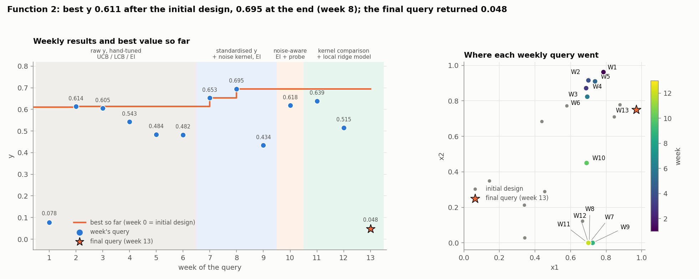
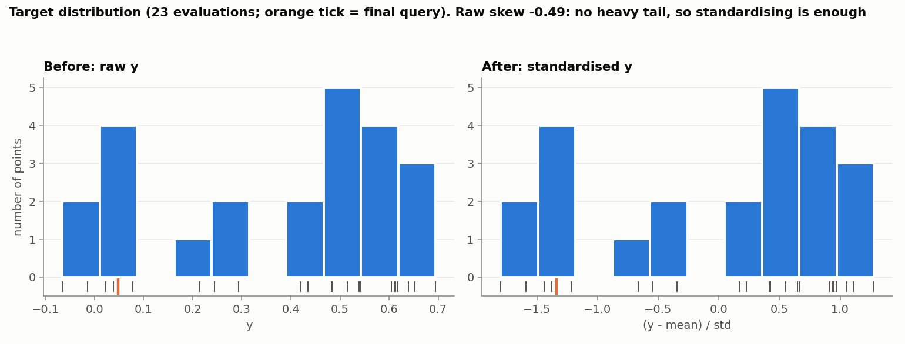
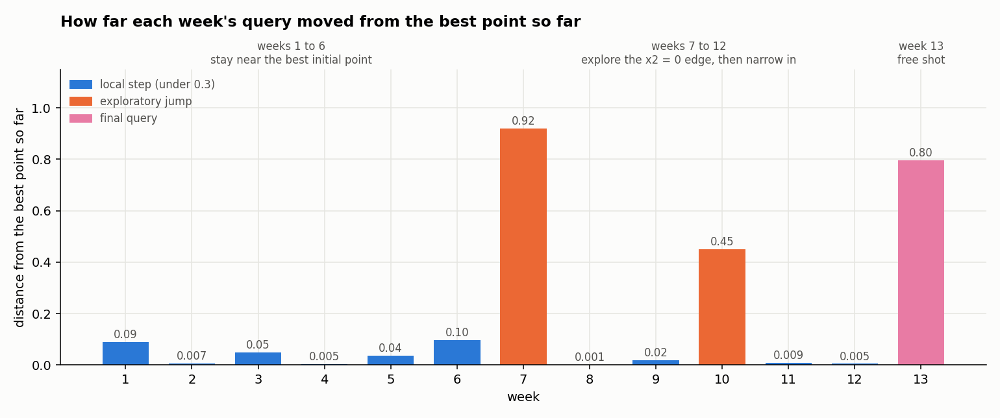
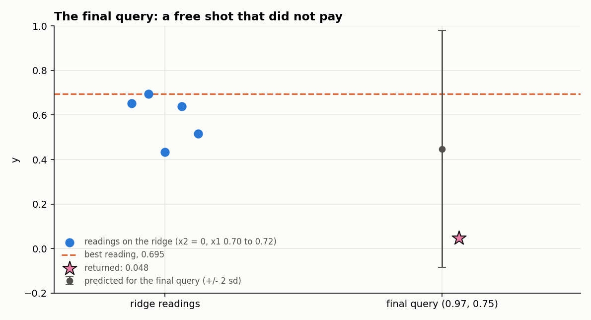

# Function 2: How the strategy evolved

Black-box optimisation, Function 2 (2 inputs in [0, 1], maximise). The report covers the strategy each week, what changed and why, and the final query. Facts (numbers, queries, outputs) come from the weekly notebooks and data and from the final results file. Weeks 7 to 13 are reproducible (fixed seed). Weeks 1 to 6 are not.

The week-13 query is candidate's D recommended point, (0.97, 0.75) from the week-13 notebook. Its result, 0.04828749, comes from the final query's result.

## Progress through the rounds

*Figure 1. Left: each weekly result and the best value so far; shading is the modelling regime. Right: where the queries went; the star is the final query.*

The initial design reached 0.611. The best then rose in only two steps: 0.614 (week 2) and 0.653 (week 7), then **0.695 (week 8)**, which stayed the best. The final query returned 0.048, so the final result is **0.6951**, at (0.704881, 0).

## 1. What Function 2 looks like

The output ranges from -0.066 to 0.695 and is **noisy**. Readings taken almost at the same point disagree by far more than the gaps between candidate points:

| Rows | Distance apart | y values | Difference |
|---|---|---|---|
| weeks 2 and 4 | 0.0045 | 0.6136, 0.5426 | 0.071 |
| weeks 7 and 8 | 0.0007 | 0.6528, 0.6951 | 0.042 |
| week 8 and week 12 | 0.0049 | 0.6951, 0.5152 | 0.180 |
| weeks 11 and 12 | 0.0036 | 0.6393, 0.5152 | 0.124 |

These pairs imply a noise standard deviation of about **0.083**; the GP's fitted value is 0.057 to 0.066. There is a ridge near x1 = 0.70, reached along both x2 ≈ 0.9 and x2 = 0, and it falls away quickly on either side in x1 (readings at x1 = 0.72 and 0.78 are 0.43 and 0.08).

## 2. Timeline

| Week | Target and surrogate | Acquisition | Query | Result |
|---|---|---|---|---|
| 1 to 6 | raw y; RBF, then isotropic Matérn GP [1, 2]; no noise term; no seed | UCB, LCB, EI [3], settings varied by hand | the ridge at x2 ≈ 0.9 | 0.078, 0.614, 0.605, 0.543, 0.484, 0.482 |
| 7 | standardised y; ARD Matérn 5/2 **plus noise term** | EI, xi 0.01 | (0.7056, 0) | 0.653 |
| 8 | same | EI | (0.7049, 0) | **0.695** |
| 9 | same; x2 length-scale bound 2 to 1 | EI | (0.7240, 0) | 0.434 |
| 10 | noise-aware EI [4]; incumbent by posterior mean | EI maximum plus a probe in x2 | (0.69, 0.45) | 0.618 |
| 11 | four kernels compared; bound raised to 10 | highest posterior mean | (0.6964, 0) | 0.639 |
| 12 | same, plus a local ridge model | mean of two ridge peaks | (0.7000, 0) | 0.515 |
| 13 | likelihood-weighted kernel average | exploration of the unexplored side | (0.97, 0.75) | 0.048 |

Weeks 1 to 6 were learning rounds. After the best initial point (0.7026, 0.9266), the proposals stayed within about 0.1 of it. The GP interpolated every reading (`alpha` = 1e-6, no noise term), so noise was treated as signal.

## 3. Target transformation: standardisation only

Unlike Function 1, the output of Function 2 has a modest range and no heavy tail (skew about -0.5 to -0.6), so the only transformation used from week 7 is standardisation, `(y − mean)/std`, kept in every week. It gives the GP a zero-mean, unit-scale target, so the noise and amplitude bounds mean the same thing every week. From week 10 onwards, all notebooks plot the distribution before and after (Figure 2). No other transformation was tried, and the evidence gives no reason for one.

*Figure 2. The target before and after standardisation (23 evaluations; the orange tick is the final query).*

## 4. What changed and why

The strategy moved from a hand-tuned search near the best initial point, to a model-driven search of the ridge, to a narrow exploitation of its top. A last free shot then went to the one unexplored region.

*Figure 3. Distance of each week's query from the best point so far. Weeks 1 to 6 stayed close to the best initial point; week 7 jumped to the x2 = 0 edge; weeks 8 to 12 were small steps; week 13 was a far exploratory shot.*

| Weeks | What the strategy did | Why |
|---|---|---|
| 1 to 6 | Hand-tuned UCB, LCB and EI, staying within about 0.1 of the best initial point. | Learning rounds: no noise term, so the model treated noise as signal. |
| 7 | Added a noise term and a fixed seed. The search moved to the x2 = 0 edge and reached the ridge again along that edge (0.653, then 0.695). | Near-duplicate readings differ by 0.04 to 0.18, so the function is noisy.|
| 8 to 10 | Narrowed x2's length-scale bound, then made EI noise-aware (incumbent by posterior mean), with one probe at x2 = 0.45. | EI was drawn to uncertain edge points (0.390 ± 0.255 against 0.662 ± 0.063 at the best), and the best single reading is flattered by noise. The probe showed x2 matters little along the ridge. |
| 11 to 12 | Compared four kernels, then queried the highest posterior mean and the average of two ridge-peak estimates, at (0.696, 0) and (0.700, 0). | Both length-scale bounds were active, so the bounds were choosing the model. The ARD Matérn 5/2 with wider bounds won; isotropic was clearly worse. |
| 13 | Explored the one region with no data. | The best could not be lowered, and further ridge readings (0.515 in week 12) were buried in the noise. |

The exploitation phase gained nothing: weeks 11 and 12 returned 0.639 and 0.515, below the 0.695 of week 8. The reason is noise. Readings 0.004 to 0.005 apart differ by up to 0.18, so the best reading is probably a favourable draw. Exploitation could not separate a better point from a lucky one, which is why the last query was spent on exploration.

## 5. The final query

*Figure 4. The five readings on the ridge, the best reading (0.695), and the final query's prediction and result.*

The last query cannot lower the score, so it was a free shot at the one region with no evidence: no reading existed with x1 > 0.75 and x2 < 0.7. The model gave (0.97, 0.75) a 17% chance of beating 0.695, against 10% for the ridge. It returned **0.048**, against a prediction of 0.448 ± 0.266. The bet did not pay, so the final result stays at **0.6951**.

## 6. Limitations

- Noise is large (about 0.07 to 0.08) next to the differences between candidates, so single readings, including the best, are weak evidence of the true height. A repeated-measurement design near (0.70, 0) would have estimated the ridge height better than single draws.
- The x2 length-scale was on a bound in every fit, so the model's belief that x2 matters little is set by the bounds as much as by the data; only one probe (week 10) tested it.

## References

1. Rasmussen, C. E. & Williams, C. K. I. (2006). *Gaussian Processes for Machine Learning*. MIT Press. (Gaussian-process regression and noise kernels.)
2. Stein, M. L. (1999). *Interpolation of Spatial Data: Some Theory for Kriging*. Springer. (Matérn kernels.)
3. Jones, D. R., Schonlau, M. & Welch, W. J. (1998). Efficient global optimization of expensive black-box functions. *Journal of Global Optimization*, 13, 455–492. (Expected improvement.)
4. Huang, D., Allen, T. T., Notz, W. I. & Zeng, N. (2006). Global optimization of stochastic black-box systems via sequential kriging meta-models. *Journal of Global Optimization*, 34, 441–466. (Optimisation under noise; incumbent by posterior mean.)
