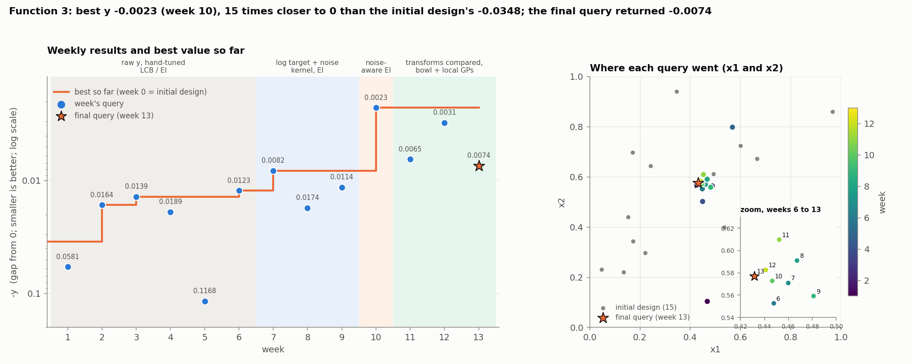
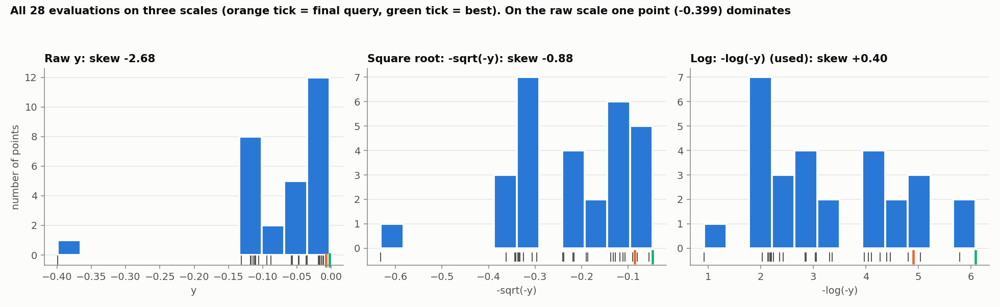
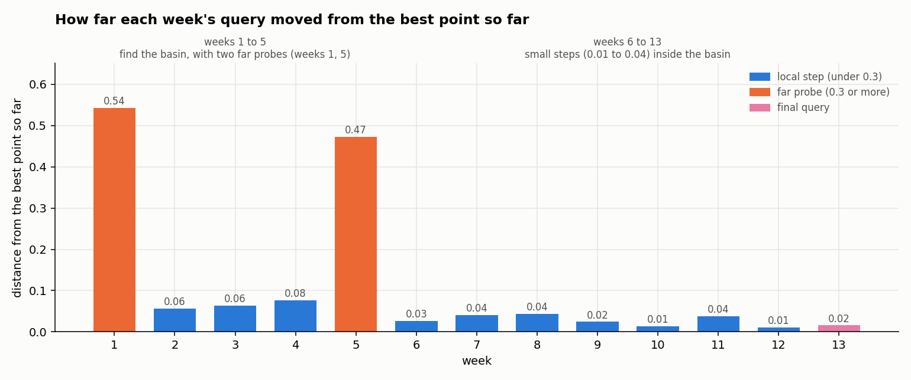
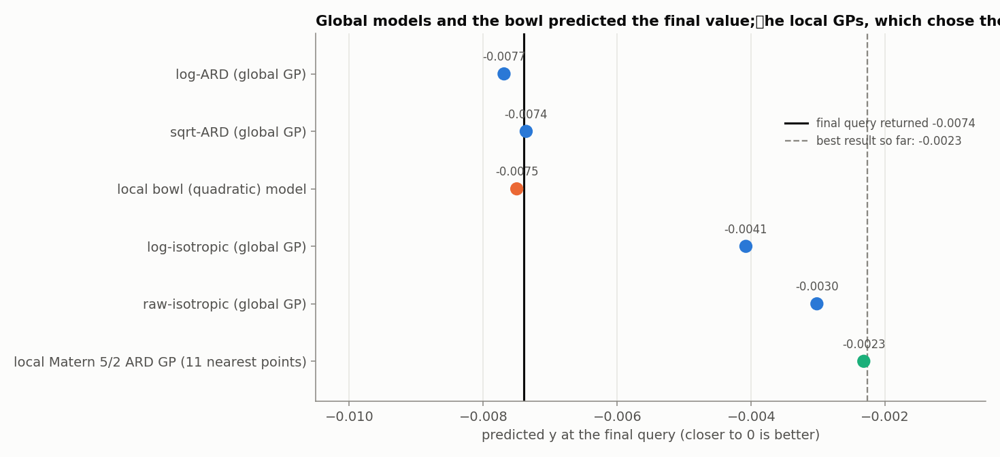

# Function 3: How the strategy evolved

Black-box optimisation, Function 3 (3 inputs in [0, 1], maximise). The report covers the strategy each week, what changed and why, and the final query. Facts (numbers, queries, outputs) come from the weekly notebooks and data and from the final result. Weeks 7 to 13 are reproducible (fixed seed). Weeks 1 to 6 are not.

The week-13 query is candidate's D from the week-13 notebook: (0.4315, 0.5769, 0.4226), the midpoint between the best point and the local-ensemble EI maximum. Its result, -0.00739914, comes from the final results file.

## Progress through the rounds

*Figure 1. Left: each weekly result as -y (smaller is better) and the best value so far; shading is the modelling regime. Right: where the queries went in x1 and x2, with a zoom on weeks 6 to 13; the star is the final query.*

The initial design (15 points) reached -0.0348. The best then improved in five steps: -0.0164 (week 2), -0.0139 (week 3), -0.0123 (week 6), -0.0082 (week 7) and **-0.002265 (week 10)**, which stayed the best. That is 15 times closer to 0 than the initial design. The final query returned -0.0074, so the final result is **-0.002265**, at (0.4465, 0.5727, 0.4237).

## 1. What Function 3 looks like

Function 3 has three inputs, and every output is negative; the best values are close to zero. The good region is one small basin around (0.45, 0.58, 0.42). Every query from week 7 on landed there, and outside it the outputs are much worse (one edge point scored -0.399). Two far-away probes, in weeks 1 and 5, were also worse than the basin.

The third input, x3, is the one the model finds most sensitive: small changes in it move y the most. The model treats x1 as nearly irrelevant, but a simple local model disagrees, so the data cannot settle this.

The function is also **noisy or very sharply varying** at small scales: queries that are very close together give slightly different values. This means small differences between candidate points are hard to trust.

## 2. Timeline

| Week | Target and surrogate | Acquisition | Query | Result |
|---|---|---|---|---|
| 1 to 6 | raw y; RBF ARD, then isotropic Matérn GP [1]; no noise term; no seed | UCB, LCB, EI [2], settings varied by hand | near the basin, plus far probes | -0.058, -0.016, -0.014, -0.019, -0.117, -0.012 |
| 7 | **-log(-y)** [3]; Matérn 5/2 + noise term; ARD against isotropic by leave-one-out | EI, xi 0.02 | (0.460, 0.571, 0.427) | -0.0082 |
| 8 | same | EI | (0.467, 0.591, 0.465) | -0.0174 |
| 9 | noise upper bound 0.1 to 0.3 | EI, xi annealed from 0.02 | (0.481, 0.559, 0.425) | -0.0114 |
| 10 | noise-aware EI [4]; incumbent by posterior mean | EI, xi 0.01 to 0.002, Sobol search | (0.447, 0.573, 0.424) | **-0.0023** |
| 11 | six models compared (3 transforms by 2 kernels); local bowl [5] | half-step to the bowl centre | (0.452, 0.610, 0.418) | -0.0065 |
| 12 | same, bowl refitted | midpoint of best point and ensemble maximum | (0.441, 0.583, 0.423) | -0.0031 |
| 13 | plus local GP ensemble | midpoint of best point and local-EI maximum | (0.432, 0.577, 0.423) | -0.0074 |

Weeks 1 to 6 were learning rounds: RBF with a length-scale per input in weeks 1 to 3, an isotropic Matérn kernel in weeks 4 to 6, no noise term (`alpha` = 1e-6), and acquisition parameters (LCB kappa 1 to 5, EI xi 0.01 to 0.1) varied by hand.

## 3. Target transformation: from raw y to -log(-y)

All outputs are negative and one is an extreme outlier (-0.399, 32 times the magnitude of the best value at week 7). A stationary GP fitted to the raw values either bends around the outlier or ignores it, so from week 7 the target is `g = -log(-y)`, which turns the multiplicative range into an additive one and cuts the skew from -2.62 to +0.28. The transformation is monotone, so maximising `g` maximises `y`. From week 10 all notebooks plot the distribution before and after (Figure 2).

*Figure 2. All 28 evaluations on the raw, square-root and log scales (orange tick: final query; green tick: best).*

In week 11 the choice was tested rather than assumed, with three transforms and two kernels:

| Model | LOO RMSE/std | Spearman | Gap between best and second best (std units) |
|---|---|---|---|
| log-ARD | **0.585** | **0.799** | 1.13 (log) |
| log-isotropic | 0.732 | 0.506 | 1.13 |
| sqrt-ARD | 0.769 | 0.785 | 0.34 (sqrt) |
| sqrt-isotropic | 0.815 | 0.658 | 0.34 |
| raw-isotropic | 0.920 | 0.744 | 0.07 (raw) |
| raw-ARD | 1.079 | 0.658 | 0.07 |

The log scale gave the best leave-one-out accuracy, and it keeps the best results apart (the raw scale makes the best two values nearly indistinguishable). The ranking held in weeks 12 and 13 (log-ARD 0.544 to 0.558 against 0.73 to 1.08 for the others).

## 4. What changed and why

The strategy moved from a search for the basin, including two far probes, to small steps inside it. Over the last weeks the steps got smaller, and the search became a careful refinement of the best point.

*Figure 3. Distance of each week's query from the best point so far. The two far probes (weeks 1 and 5) are orange; from week 6 on, every step is 0.05 or less.*

| Weeks | What the strategy did | Why |
|---|---|---|
| 1 to 5 | Hand-tuned UCB, LCB and EI. Two far probes (weeks 1 and 5) and a search around the basin. | Learning rounds, with no noise term. The probes returned -0.058 and -0.117, worse than the basin. |
| 7 | Switched to the -log(-y) target, added a noise term and chose the kernel by cross-validation. The query (0.460, 0.571, 0.427) returned -0.0082, a new best. | One extreme outlier (-0.399) distorts a fit on the raw values, and near-duplicate points suggest noise (inference). |
| 8 to 10 | Widened the noise bound, shrank the exploration setting (xi), and made EI noise-aware. Week 10 returned **-0.002265**, the best of the campaign. | The week-8 query returned a worse value (-0.0174) within 0.04 of week 7, which is interpeted as local jitter, not a sharper optimum.|
| 11 to 12 | Compared six models, fitted a local bowl-shaped model, and stepped part of the way towards the bowl centre or the models' consensus. Results -0.0065 and -0.0031. | The global models' EI maxima were far from the basin and not trusted; the local model was a safer guide near the best point. |
| 13 | Added local GPs fitted to the points near the best, and took the midpoint between the best point and their EI maximum. | A final small step, 0.016 from the best point. |

None of the three queries after week 10 beat -0.002265. The steps were 0.01 to 0.04 while neighbouring readings differ by 0.001 to 0.006, so the best reading is probably a favourable draw, and later queries could not tell a better point from a lucky one.

## 5. The final query

*Figure 4. Predicted y at the final query by each approach (refitted on the 27 earlier points), against the value returned and the best so far.*

The final query returned **-0.0074**, worse than the best so far (-0.002265). The last query cannot lower the score, so the final result stays at **-0.002265**.

## 6. Limitations

- Noise or very sharp local variation is large next to the differences between candidates, so single readings, including the best, are weak evidence of the true height. Repeated queries at the best point would have estimated its level better than neighbouring points did.
- x1 sits on its ARD bound in every fit, so the finding that it does not matter is set by the bound as much as the data, and the bowl disagrees.
- Only the far probes of weeks 1 and 5 looked outside the basin, and the extreme outlier at (0.152, 0.440, 0.991) was never revisited.

## References

1. Rasmussen, C. E. & Williams, C. K. I. (2006). *Gaussian Processes for Machine Learning*. MIT Press. (Gaussian-process regression, noise kernels, ARD, leave-one-out validation.)
2. Jones, D. R., Schonlau, M. & Welch, W. J. (1998). Efficient global optimization of expensive black-box functions. *Journal of Global Optimization*, 13, 455–492. (Expected improvement.)
3. Box, G. E. P. & Cox, D. R. (1964). An analysis of transformations. *Journal of the Royal Statistical Society B*, 26, 211–252. (Power and log transformations.)
4. Huang, D., Allen, T. T., Notz, W. I. & Zeng, N. (2006). Global optimization of stochastic black-box systems via sequential kriging meta-models. *Journal of Global Optimization*, 34, 441–466. (Optimisation under noise; incumbent by posterior mean.)
5. Eriksson, D., Pearce, M., Gardner, J., Turner, R. D. & Poloczek, M. (2019). Scalable global optimization via local Bayesian optimization. *NeurIPS 32*. (Local models.)
