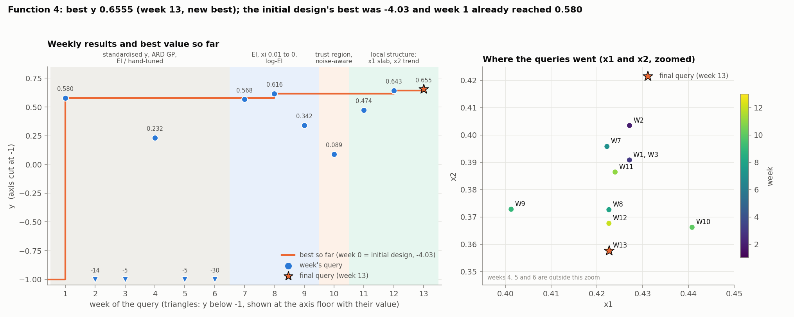
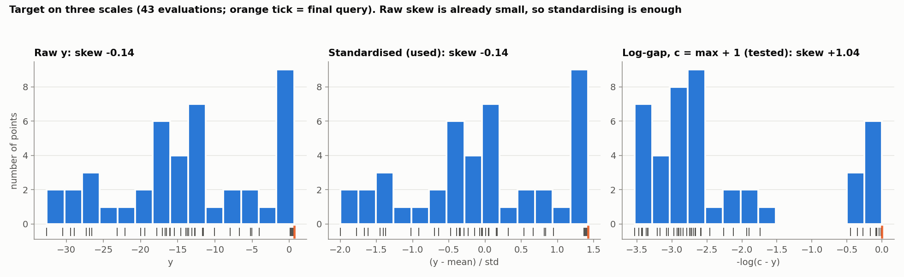
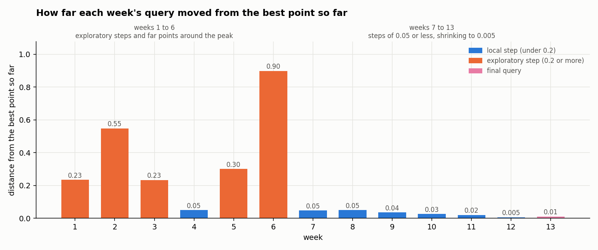
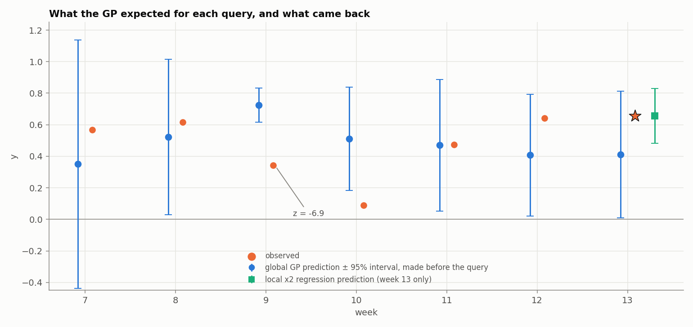

# Function 4: How the strategy evolved

Black-box optimisation, Function 4 (4 inputs in [0, 1], maximise). The report covers the strategy each week, what changed and why, and the final query. Facts (numbers, queries, outputs) come from the weekly notebooks and data and from the final result. Weeks 7 to 13 are reproducible (fixed seed). Weeks 1 to 6 are not. 

The week-13 query is candidate's D of the week-13 analysis, (0.422604, 0.357638, 0.406408, 0.426606): the week-12 best point with x2 lowered by a further 0.010. Its result, 0.65546491, comes from the final query's result.

## Progress through the rounds

*Figure 1. Left: each weekly result and the best value so far (values below -1 are drawn on the axis floor with their value); shading is the modelling regime. Right: where the queries went in x1 and x2, zoomed on the good region; the star is the final query.*

The 30 initial points all scored below -4 (best -4.03). The first query already reached **0.580**, so almost all of the improvement came in week 1. After that the best crept up in three small steps: 0.616 (week 8), 0.643 (week 12) and **0.6555 (week 13)**, the final query, which is the final result at (0.422604, 0.357638, 0.406408, 0.426606).

## 1. What Function 4 looks like

Function 4 has a **narrow peak** near (0.42, 0.37 to 0.39, 0.36 to 0.41, 0.41 to 0.43). Away from it the outputs are very low: the 30 initial points all scored below -4, and moving one input by 0.1 to 0.3 from the peak drops y by 5 to 30.

Close to the peak the function is still very sensitive, most of all to x1: a shift of only 0.02 in x1 (and in x4) took a query from about 0.64 to 0.09. The input with the most room to move is x2.

## 2. Timeline

| Week | Target and surrogate | Acquisition | Query | Result |
|---|---|---|---|---|
| 1 to 6 | raw y; RBF ARD, then isotropic Matérn GP [1]; no noise term; no seed | UCB, LCB, EI [2], hand-tuned; local one-at-a-time probes around the best | week 1 (0.427, 0.391, 0.363, 0.412), then probes and far points | 0.580, -13.9, -5.2, 0.232, -5.0, -30.5 |
| 7 | standardised y; ARD Matérn 5/2 + noise kernel | EI, xi 0.01 | (0.4222, 0.3958, 0.4069, 0.4271) | 0.568 |
| 8 | same | EI | (0.4226, 0.3726, 0.4064, 0.4266) | **0.616** |
| 9 | same; log-EI [3] | log-EI, xi 0 | (0.4012, 0.3728, 0.3840, 0.4096) | 0.342 |
| 10 | noise-aware EI [4] | EI, xi 0.005, trust region 0.12 [5] | (0.4408, 0.3662, 0.4040, 0.4441) | 0.089 |
| 11 | transforms compared | centroid of the three best points | (0.4240, 0.3864, 0.3920, 0.4219) | 0.474 |
| 12 | local structure analysis | best point with x2 lowered by 0.005 | (0.4226, 0.3676, 0.4064, 0.4266) | **0.643** |
| 13 | local regression along x2 | best point with x2 lowered by 0.010 | (0.4226, 0.3576, 0.4064, 0.4266) | **0.655** |

Weeks 1 to 6 were learning rounds: RBF with a length-scale per input in weeks 1 to 3, an isotropic Matérn kernel in weeks 4 to 6, no noise term (`alpha` = 1e-6), and acquisition settings (LCB kappa 1 to 5, EI xi 0.01 to 0.1) varied by hand. After the week-1 success, weeks 2 to 4 changed one to four inputs around it (-13.9, -5.2, 0.232), week 5 moved further (-5.0) and week 6 went to a far corner (-30.5), which showed how narrow the peak is.

## 3. Target transformation: standardisation only

y spans about 33 units, with the best points near +0.6 and most others far below, so from week 7 the target is standardised, `(y - mean)/std`, with the training statistics recomputed each week. A log cannot be used because y crosses zero and the best values are positive. The raw skew is small (-0.10 by week 12), so no further transformation was needed. From week 10 all notebooks plot the distribution before and after (Figure 2).

*Figure 2. The target on the raw, standardised and log-gap scales (43 evaluations; the orange tick is the final query).*

In week 11 the choice was tested against a "log-gap" transform, `-log(c − y)` with `c` just above the maximum (c = max + 1 and max + 0.3). Standardising won clearly, and the margin held in weeks 12 and 13:

| Model (week 11) | LOO RMSE/std | Spearman | Fitted noise sd (y) |
|---|---|---|---|
| standardised, ARD | **0.157** | **0.983** | 0.196 |
| standardised, isotropic | 0.163 | 0.982 | 0.196 |
| log-gap, c = max + 1 | 0.264 | 0.810 | 1.30 |
| log-gap, c = max + 0.3 | 0.347 | 0.653 | 2.01 |

Both log-gap versions pushed some length-scales to the bound and inflated the noise estimate to 1.2 to 2.0 in y units, a sign the shape was not a better description.

## 4. What changed and why

The strategy moved from exploration to exploitation. Weeks 1 to 6 explored around and away from the peak. Weeks 7 to 10 let a Gaussian-process model choose the queries. From week 11 I read the neighbourhood of the best point directly and moved in small steps (about 0.02 or less) along the one direction that paid off.

*Figure 3. Distance of each week's query from the best point so far. Weeks 1 to 6 include exploratory steps of 0.2 to 0.9; from week 7 every step is 0.05 or less.*

| Weeks | What the strategy did | Why |
|---|---|---|
| 1 to 6 | Hand-tuned UCB, LCB and EI. Week 1 jumped from -4.03 to **0.580**; the next queries probed around it and went to far points (-13.9, -5.2, 0.232, -5.0, -30.5). | Learning rounds. They showed how narrow the peak is. |
| 7 to 8 | Standardised target, ARD Matérn GP with a noise term, EI. Results 0.568 and **0.616** (new best). | A noise term for near-duplicate points; a standardised target because y crosses zero, so a log is impossible. |
| 9 to 10 | Log-EI, then noise-aware EI in a trust region. Week 9 returned 0.342 against a prediction of 0.724 ± 0.055; week 10 returned 0.089. | Plain EI underflowed to about zero. After the week-9 miss I added caution; week 10 moved x1 and x4 by +0.018 and y collapsed, which showed the x1 sensitivity. |
| 11 to 12 | Stopped relying on the GP. The centroid of the three best points returned 0.474; lowering x2 by 0.005 returned **0.643** (new best). | The GP's own slope pointed the wrong way along x2; reading the neighbours showed that lowering x2 helped. |
| 13 | A regression along x2 inside the slab; lowered x2 a further 0.010. Result **0.6555** (new best). | The regression supported one more small step in the direction that had just paid off, with x1, x3 and x4 unchanged. |

Almost all of the gain came from the first query (week 1). The later improvements were small (0.616, 0.643, 0.6555), and they came from the local steps.

## 5. The final query

*Figure 4. The global GP's prediction (± 95%) before each query, against what came back; for the final query the local regression's prediction is also shown.*

The final query returned **0.6555**, a new best (+0.013), so it is the final result. The local regression had predicted 0.656 ± 0.089 and the global GP 0.411 ± 0.205.

## 6. Limitations

- **The final gain is small.** +0.013 is much less than the global GP's fitted noise standard deviation (0.15 to 0.20), although the scatter among readings in the slab is smaller (0.05 to 0.06).
- **The slab regression rests on 5 to 6 readings and two parameters.** It finds a trend but no maximum, and extrapolating further in x2 is untested.
- **The global GP was a poor guide near the peak** (length-scales above the cube width, a 6.9-sigma miss in week 9). Most of the late gains came from reading the neighbourhood directly.
- **Only one basin was explored.** The other 29 initial points are all far below it, so another basin is unlikely but cannot be excluded.

## References

1. Rasmussen, C. E. & Williams, C. K. I. (2006). *Gaussian Processes for Machine Learning*. MIT Press. (Gaussian-process regression, ARD and noise kernels, leave-one-out validation.)
2. Jones, D. R., Schonlau, M. & Welch, W. J. (1998). Efficient global optimization of expensive black-box functions. *Journal of Global Optimization*, 13, 455–492. (Expected improvement.)
3. Ament, S., Daulton, S., Eriksson, D., Balandat, M. & Bakshy, E. (2023). Unexpected improvements to expected improvement for Bayesian optimization. *NeurIPS 36*. (Log-EI to avoid vanishing gradients.)
4. Huang, D., Allen, T. T., Notz, W. I. & Zeng, N. (2006). Global optimization of stochastic black-box systems via sequential kriging meta-models. *Journal of Global Optimization*, 34, 441–466. (Noisy optimisation; incumbent by posterior mean.)
5. Eriksson, D., Pearce, M., Gardner, J., Turner, R. D. & Poloczek, M. (2019). Scalable global optimization via local Bayesian optimization. *NeurIPS 32*. (Trust regions.)
