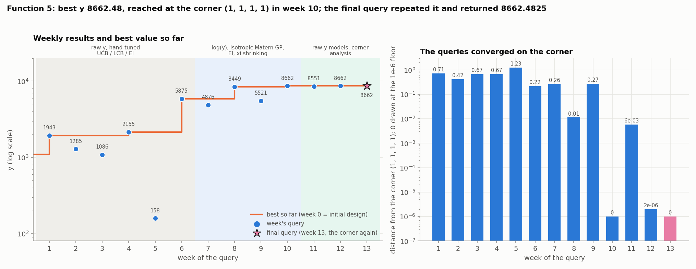
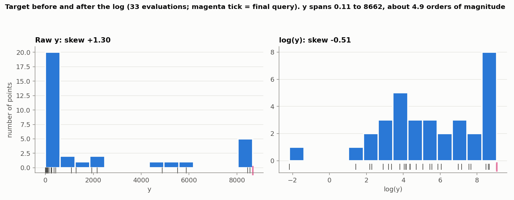
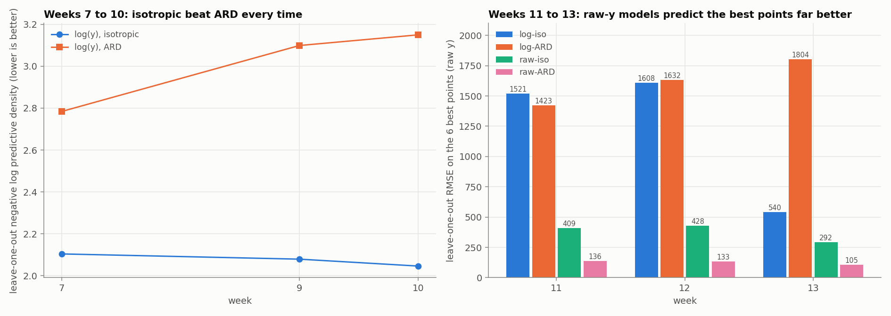
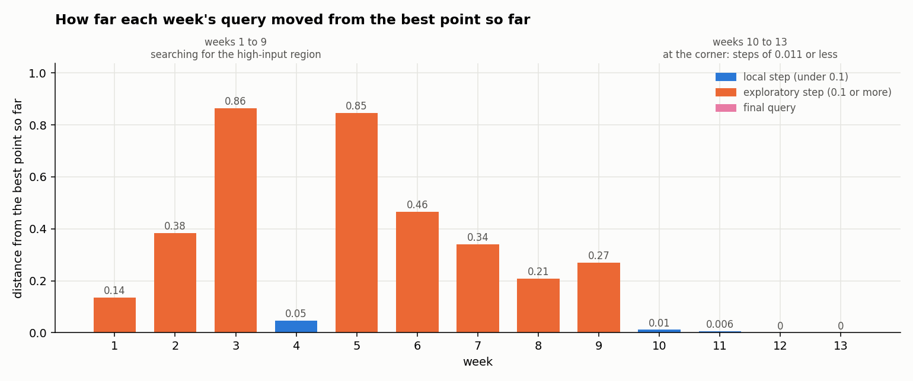
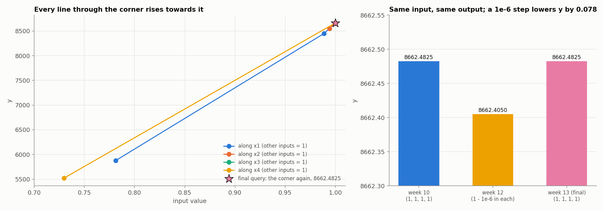

# Function 5: How the strategy evolved

Black-box optimisation, Function 5 (4 inputs in [0, 1], maximise). The report covers the strategy each week, what changed and why, and the final query. Facts (numbers, queries, outputs) come from the weekly notebooks and data and from the final query's result. Weeks 7 to 13 are reproducible (fixed seed). Weeks 1 to 6 are not.

The week-13 query is  candidate's A of the week-13 notebook, the corner (1, 1, 1, 1) again. Its result, 8662.4825, comes from the final query's result.

## Progress through the rounds

*Figure 1. Left: each weekly result and the best value so far (log scale); shading is the modelling regime. Right: how far each query was from the corner (1, 1, 1, 1).*

The 20 initial points reached 1089. The best then rose in five steps: 1943 (week 1), 2155 (week 4), 5875 (week 6), 8449 (week 8) and **8662.4825 (week 10)**, at the corner (1, 1, 1, 1). The final query repeated the corner and returned the identical value, so the final result is **8662.4825**.

## 1. What Function 5 looks like

Function 5 is a steep function that **increases towards the corner (1, 1, 1, 1)**. All outputs are positive and span almost five orders of magnitude, from 0.11 to 8662, and along every line through the corner y rises as the input approaches 1. The maximum observed is therefore on the boundary of the domain.

The function is also **deterministic**: the same input returns exactly the same value, and two points 2e-6 apart differ by only 0.08. So small differences between queries are real, not noise.

## 2. Timeline

| Week | Target and surrogate | Acquisition | Query | Result |
|---|---|---|---|---|
| 1 to 6 | raw y; RBF ARD, then isotropic Matérn GP [1]; no noise term; no seed | UCB, LCB, EI [2], hand-tuned | wandering; week 6 reached (0.78, 1, 1, 1) | 1943, 1285, 1086, 2155, 158, 5875 |
| 7 | **log(y)**; isotropic Matérn 5/2 + noise term | EI, xi 0.01 | (1, 1, 0.745, 0.947) | 4876 |
| 8 | same | EI-based; a nudge of x1 near the incumbent | (0.989, 1, 1, 1) | 8449 |
| 9 | log vs raw compared; xi 0.002 | EI | (1, 1, 1, 0.730) | 5521 |
| 10 | audit; xi 0.0001; trust region [3] | EI plus a UCB cross-check | (1, 1, 1, 1) | **8662.48** |
| 11 | four models compared | highest-probability candidates | (1, 0.994, 1, 1) | 8551 |
| 12 | same; determinism test | corner less 1e-6 in each input | (0.999999, 0.999999, 0.999999, 0.999999) | 8662.405 |
| 13 | same | the corner again | (1, 1, 1, 1) | 8662.4825 |

Weeks 1 to 6 were learning rounds: RBF with a length-scale per input in weeks 1 to 3, an isotropic Matérn kernel in weeks 4 to 6, no noise term, and acquisition settings (LCB kappa 1 to 5, EI xi 0.01 to 0.1) varied by hand. They found the high-input region: the week-6 query (0.781, 1, 1, 1) returned 5875, a 2.7-fold gain over any earlier result.

## 3. Target transformation: log first, Raw-y after and then both

On week-7, I applied and compared 2 transformations on the target y. A `log(y)` and a Box-Cox fit [4]. The `log(y)`, citing the 4.7 orders of magnitude and a skew of 3.26. A Box-Cox fit gave lambda = 0.089, close to 0 (the log transform), so the log was kept as the data-driven choice. The Box-Cox lambda stayed near 0.07 afterwards so the log was kept. From week-10 onwards, all notebooks plot the distribution before and after (Figure 2).

*Figure 2. The target on the raw and log scales (33 evaluations; the magenta tick is the final query).*

In week 9 the log was tested against standardised raw y by leave-one-out. In their own units the log models scored 2.08 (isotropic) and 3.10 (ARD) against 7.29 and 76.3 for the raw models, and on a common y scale the log-isotropic model was better (6.99 against 7.28). From week 11, with the best points all near the corner, the question changed from "which model fits everything" to "which predicts the best points", and both transforms were kept:

| Model (week 11) | LOO RMSE/std (own scale) | Spearman | RMSE on the 6 best points (raw y) |
|---|---|---|---|
| log-isotropic | 0.611 | 0.809 | 1521 |
| log-ARD | 0.586 | 0.852 | 1423 |
| raw-isotropic | 0.120 | 0.819 | 409 |
| **raw-ARD** | **0.097** | 0.838 | **136** |

The raw-y models were far better on the points that matter, and the ordering held in weeks 12 and 13 (raw-ARD 133 and 105 against 1632 and 1804 for log-ARD, Figure 3).

*Figure 3. Left: weeks 7 to 10, log(y) with isotropic against ARD kernels, by leave-one-out density. Right: weeks 11 to 13, error on the six best points for each of the four models.*

## 4. What changed and why

The strategy moved from exploration to exploitation. Weeks 1 to 9 searched for the high-input region and each query moved 0.05 to 0.86 from the best point so far. From week 10 I stayed at the corner and used the last queries to check that it really is the maximum.

*Figure 4. Distance of each week's query from the best point so far (a distance of 0 in weeks 12 and 13 means the corner or a 1e-6 step from it). Weeks 1 to 9 explore; weeks 10 to 13 are at the corner.*

| Weeks | What the strategy did | Why |
|---|---|---|
| 1 to 6 | Hand-tuned UCB, LCB and EI. Week 6 reached (0.78, 1, 1, 1) and returned 5875. | Learning rounds. They found that high inputs are good: week 6 was 2.7 times any earlier result. |
| 7 | Log target, isotropic Matérn GP with a noise term, EI. Result 4876. | y spans almost five orders of magnitude, so a log scale suits the model. |
| 8 to 9 | A small nudge of x1 returned 8449; then a lower exploration setting (xi 0.002) proposed (1, 1, 1, 0.730), which returned 5521. | With the budget shrinking, exploration was cut back. Lowering x4 by 0.27 cost 36%, which showed y rises with every input. |
| 10 | Trust region around the best point, a much lower exploration setting (xi 0.0001), and a cross-check with UCB. The query was the corner, returning **8662.48**. | The data pointed to the corner, so I stopped exploring. |
| 11 to 13 | Compared four models (log and raw targets), then a 1e-6 step from the corner returned 8662.405, and repeating the corner returned 8662.4825 again. | The log models and the raw models disagreed about whether the corner was the maximum, and the raw models were far better on the best points. The repeat confirmed the exact value. |

Every small step away from the corner was predicted to lose (by 7 to 123), and the opposite corner much more, so nothing beat the corner.

## 5. The final query

*Figure 5. Left: y along each line through the corner, with the final query. Right: the same input returns the same value, and a 1e-6 step lowers y by 0.078.*

The final query repeated the corner (1, 1, 1, 1) and returned **8662.4825**, identical to week 10. The final result is **8662.4825**.

## 6. Limitations

- **The maximum is on the boundary.** Every direction of the corner was tested only by single steps of 0.006 to 0.27 in one input at a time, and by a simultaneous 1e-6 step. The finding that the corner is the maximum rests on monotone increase along those lines and on the model predictions, not on a search of the other regions.
- **Large parts of the feature space are unexplored.** Few queries left the high corner after the initial design (week 5 at (0.31, 0.18, 0.98, 0.40) returned 158). The best exploratory point under the raw models had a very low chance of beating the corner (0.17%, 0.02%), so another maximum there is unlikely but not excluded.
- **The surrogate disagreed with the data in direction at times.** The log models fitted the whole range but missed the best points by 1400 to 1800; the raw-ARD model was better there (105 to 136).

## References

1. Rasmussen, C. E. & Williams, C. K. I. (2006). *Gaussian Processes for Machine Learning*. MIT Press. (Gaussian-process regression, ARD and noise kernels, leave-one-out validation.)
2. Jones, D. R., Schonlau, M. & Welch, W. J. (1998). Efficient global optimization of expensive black-box functions. *Journal of Global Optimization*, 13, 455–492. (Expected improvement.)
3. Eriksson, D., Pearce, M., Gardner, J., Turner, R. D. & Poloczek, M. (2019). Scalable global optimization via local Bayesian optimization. *NeurIPS 32*. (Trust regions.)
4. Box, G. E. P. & Cox, D. R. (1964). An analysis of transformations. *Journal of the Royal Statistical Society B*, 26, 211–252. (Choosing a power transform.)
