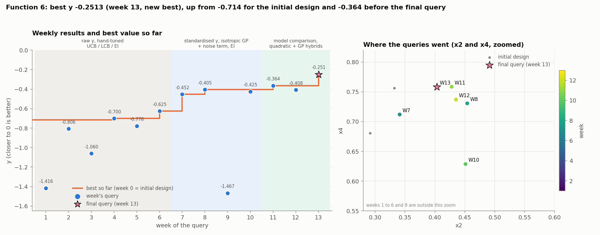
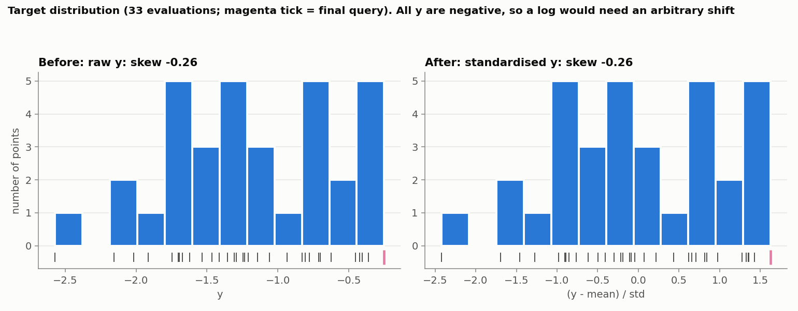
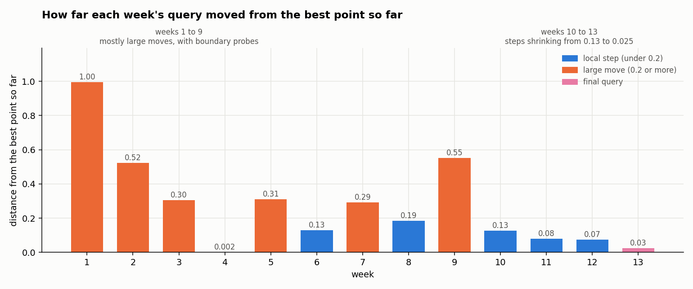
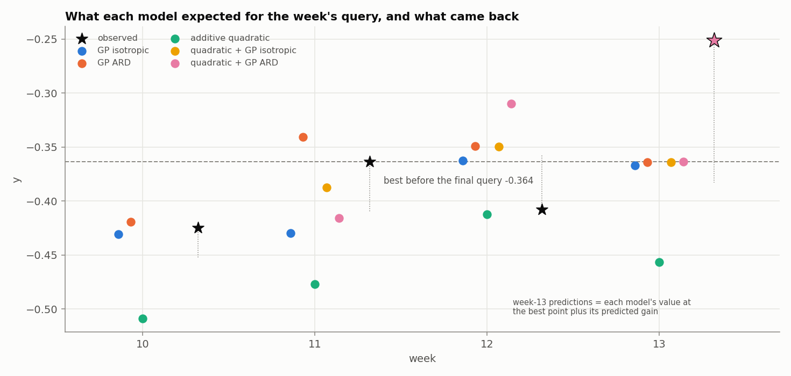

# Function 6: How the strategy evolved

Black-box optimisation, Function 6 (5 inputs in [0, 1], maximise). The report covers the strategy each week, what changed and why, and the final query. Facts (numbers, queries, outputs) come from the weekly notebooks and data and from the final query's result. Weeks 7 to 13 are reproducible (fixed seed). Weeks 1 to 6 are not.

The week-13 query is candidate's F of the week-13 analysis, (0.441509, 0.402941, 0.450140, 0.758566, 0.062893): the best point with x2 lowered by 0.025. Its result, -0.25133507, comes from the final query's result.

## Progress through the rounds

*Figure 1. Left: each weekly result and the best value so far; shading is the modelling regime. Right: where the queries went in x2 and x4, zoomed on the good region; the star is the final query.*

The best of the 20 initial points was -0.714. It improved in six steps: -0.700 (week 4), -0.625 (week 6), -0.453 (week 7), -0.405 (week 8), -0.364 (week 11) and **-0.2513 (week 13)**, the final query. That is a 2.8-fold reduction in the gap to zero, and the final query alone added 0.113, the largest single gain after week 7. The final result is **-0.2513**, at (0.441509, 0.402941, 0.450140, 0.758566, 0.062893).

## 1. What Function 6 looks like

Function 6 has five inputs, and every output is negative (from -2.57 to -0.25). The good region is one smooth basin around (0.43 to 0.47, 0.40 to 0.45, 0.42 to 0.50, 0.63 to 0.76, 0.01 to 0.13). Queries at the edge of the domain did badly.

Inside the basin the function behaves like a smooth bowl: a simple quadratic in each input describes it well, and it curves downwards in every input. The fifth input, x5, matters least. The function is only slightly noisy, so most differences between queries are real.

## 2. Timeline

| Week | Target and surrogate | Acquisition | Query | Result |
|---|---|---|---|---|
| 1 to 6 | raw y; RBF ARD, then isotropic Matérn GP [1]; no noise term; no seed | UCB, LCB, EI [2], hand-tuned | boundary probes, then a region near (0.7, 0.15, 0.6 to 0.7, 0.65 to 0.7, 0.06) | -1.416, -0.807, -1.060, -0.700, -0.778, -0.625 |
| 7 | standardised y; isotropic Matérn 5/2 + noise term | EI, xi 0.01 | (0.529, 0.341, 0.513, 0.712, 0.182) | -0.453 |
| 8 | same | EI | (0.434, 0.454, 0.417, 0.731, 0.126) | **-0.405** |
| 9 | same | EI | (0.278, 0.827, 0.186, 1, 0) | -1.467 |
| 10 | adds an additive-quadratic cross-check [3] | EI, Sobol-seeded optimiser | (0.472, 0.451, 0.460, 0.629, 0.078) | -0.425 |
| 11 | five models compared | half-step to the ARD EI point | (0.442, 0.428, 0.450, 0.759, 0.063) | **-0.364** |
| 12 | same | ensemble-mean maximum | (0.436, 0.435, 0.500, 0.737, 0.013) | -0.408 |
| 13 | forward test of the models | best point, x2 lowered by 0.025 | (0.442, 0.403, 0.450, 0.759, 0.063) | **-0.251** |

Weeks 1 to 6 were learning rounds: RBF with a length-scale per input in weeks 1 to 3, an isotropic Matérn kernel in weeks 4 to 6, no noise term, and acquisition settings varied by hand. They found a fair region near (0.7, 0.15, 0.6 to 0.7, 0.65 to 0.7, 0.06) by weeks 4 to 6; the better basin, near (0.45, 0.4, 0.45, 0.7, 0.1), was found by the week-7 model.

## 3. Target transformation: standardisation only

From week 7 y is standardised, `(y - mean)/std`. A log or Box-Cox transform were rouuled out because every y is negative (a log would need an arbitrary shift) and the distribution shows no strong skew; the skew is -0.28 in week 11 (Figure 2). Standardising keeps the GP's amplitude and noise bounds on a fixed scale, and the notebooks plot before and after from week 7.

*Figure 2. The target before and after standardisation (33 evaluations; the magenta tick is the final query).*

## 4. What changed and why

The strategy moved from exploration to exploitation. Weeks 1 to 9 were mostly large moves, with probes at the edge of the domain. From week 10 the steps shrank, from 0.13 to 0.025 in the last query, and the last query changed a single input.

*Figure 3. Distance of each week's query from the best point so far. Weeks 1 to 9 include large moves (0.2 to 1.0); from week 10 every step is 0.13 or less.*

| Weeks | What the strategy did | Why |
|---|---|---|
| 1 to 6 | Hand-tuned UCB, LCB and EI. Boundary probes, then a fair region near (0.7, 0.15, 0.6 to 0.7, 0.65 to 0.7, 0.06). Best -0.625. | Learning rounds. |
| 7 to 8 | Standardised target, isotropic Matérn GP with a noise term, EI. Results -0.453 and **-0.405**. | A noise term for near-duplicate points; isotropic beat ARD on leave-one-out, since ARD overfits 26 points in 5 dimensions (inference). This found the better basin. |
| 9 | EI proposed an edge point, (0.278, 0.827, 0.186, 1, 0), which returned -1.467. | A high-uncertainty extrapolation, not an improvement. |
| 10 | Added a simple quadratic model as a cross-check and a better optimiser. Result -0.425. | The quadratic predicted held-out points better than either GP. |
| 11 to 12 | Compared five models and moved half a step towards the ARD EI point (-0.364, a new best), then to the ensemble-mean maximum (-0.408). | The quadratic and the hybrid models were best overall, but the ARD GP was best on the top points. Week 12's recommendation failed: the GP models over-predicted. |
| 13 | Moved only x2, from 0.428 to 0.403. Result **-0.2513**, a gain of 0.113. | All five models agreed that lowering x2 would help, though none could rank small steps reliably. |

The final single-input step gained more than all the earlier refinements. The models' predicted gain was only 0.001 to 0.007.

## 5. The final query

*Figure 4. The value each model expected for the week's query (weeks 10 to 13) and the value returned (stars).*

The final query returned **-0.2513**, a new best and a gain of +0.113 over the previous best. The models predicted a gain of at most 0.007, so the direction was right and the size much larger than expected. The final result is **-0.2513**.

## 6. Limitations

- **The final gain was far larger than any model predicted.** That suggests the models are not reliable guides to the step size near the peak, and that the best point may not have been close to the optimum in x2 even after week 11.
- **Only x2 was tested.** The additive quadratic puts the peak at x3 about 0.61 and x5 = 0, away from the best point's 0.450 and 0.063, and the GPs disagree with it (they predict -0.49 to -0.51 there). No query tested those inputs one at a time near the best, so further gains in x3 and x5 are possible but unevidenced.
- **Noise is small but real** (a 0.014 difference at 0.002 distance), so small gains are hard to separate from noise; the +0.113 is well beyond it.

## References

1. Rasmussen, C. E. & Williams, C. K. I. (2006). *Gaussian Processes for Machine Learning*. MIT Press. (Gaussian-process regression, ARD and noise kernels, leave-one-out validation.)
2. Jones, D. R., Schonlau, M. & Welch, W. J. (1998). Efficient global optimization of expensive black-box functions. *Journal of Global Optimization*, 13, 455–492. (Expected improvement.)
3. Hastie, T., Tibshirani, R. & Friedman, J. (2009). *The Elements of Statistical Learning* (2nd ed.). Springer. (Polynomial regression and cross-validation.)
