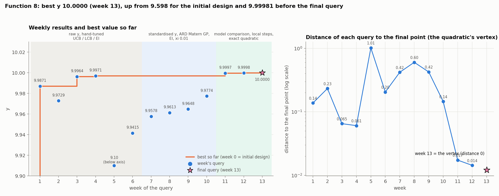
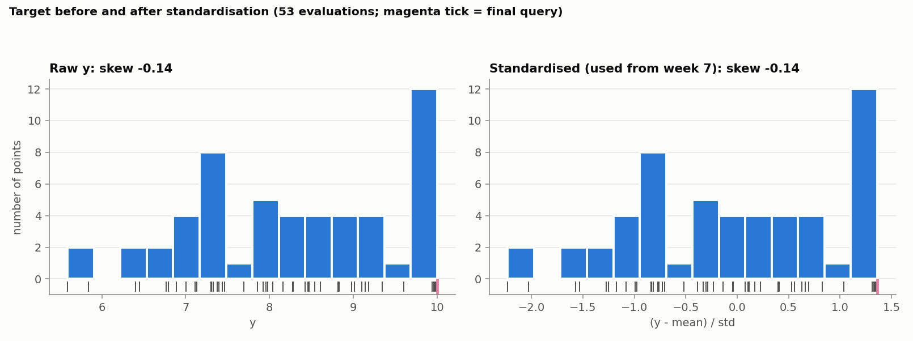
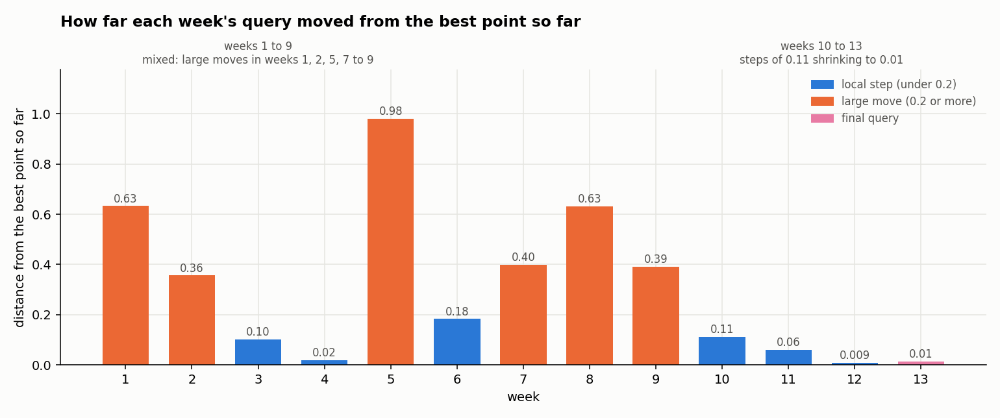
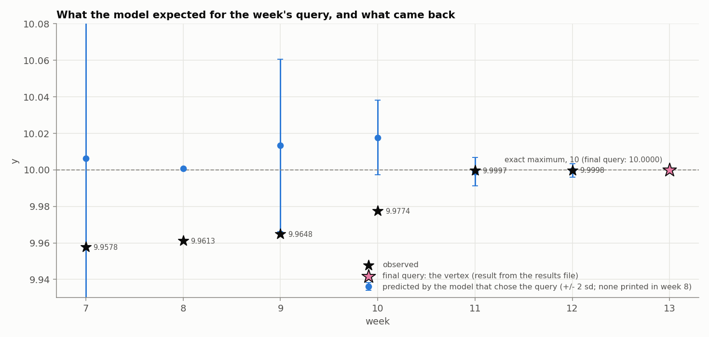

# Function 8: How the strategy evolved

Black-box optimisation, Function 8 (8 inputs in [0, 1], maximise). The report covers the strategy each week, what changed and why, and the final query. Facts (numbers, queries, outputs) come from the weekly notebooks and data and from the final query's result. Weeks 7 to 13 are reproducible (fixed seed). Weeks 1 to 5 are not (week 6 sets a seed). 

The week-13 query is from candidate G of the week-13 notebook, the vertex of the fitted quadratic, (0.10, 0.15, 0.13, 0.15, 0.80, 0.50, 0.20, 0.60). Its result, 10.0000, comes from the final query's results.

## Progress through the rounds

*Figure 1. Left: each weekly result and the best value so far; shading is the modelling regime. Right: distance of each query to the final point.*

The best of the 40 initial points was 9.598. It rose in five steps: 9.9871 (week 1), 9.9964 (week 3), 9.9971 (week 4), 9.9997 (week 11), 9.9998 (week 12) and **10.0000 (week 13)**, the final query. Between week 4 and week 11 no query improved on 9.9971: weeks 5 to 10 returned 9.10, 9.94, 9.96, 9.96, 9.96 and 9.98. The final result is **10.0000**, at (0.10, 0.15, 0.13, 0.15, 0.80, 0.50, 0.20, 0.60).

## 1. What Function 8 looks like

Function 8 has eight inputs, and its output ranges from 5.6 to 10.0. In week 13 it was found that this is an **exact quadratic bowl** with a single maximum of 10, at (0.10, 0.15, 0.13, 0.15, 0.80, 0.50, 0.20, 0.60). A fit to the first 40 points alone predicted the next 12 to machine precision.

The function is deterministic, so small gains are real differences. The last input, x8, matters least; the others matter 5 to 30 times more.

## 2. Timeline

| Week | Target and surrogate | Acquisition | Query | Result |
|---|---|---|---|---|
| 1 to 3 | raw y; RBF ARD [1]; no noise term; no seed | UCB, LCB, EI [2], hand-tuned | near (0.08 to 0.13, 0.16 to 0.21, 0.12 to 0.16, 0.11 to 0.16, 0.69 to 1, 0.48 to 0.53, 0.19 to 0.20, 0.57 to 0.70) | 9.9871, 9.9729, 9.9964 |
| 4 to 6 | raw y; isotropic Matérn GP | same | week 4 (0.099, 0.199, 0.133, 0.154, 0.785, 0.514, 0.191, 0.628); week 5 far away | 9.9971, 9.0991, 9.9415 |
| 7 | standardised y; ARD Matérn 5/2 + noise term | EI, xi 0.01 | (0.036, 0.137, 0.092, 0.189, 0.856, 0.490, 0.128, 1) | 9.9578 |
| 8 | same | EI | (0.123, 0.153, 0.116, 0.130, 0.813, 0.495, 0.184, 0) | 9.9613 |
| 9 | same | EI | (0.141, 0.226, 0.132, 0.076, 0.730, 0.455, 0.195, 1) | 9.9648 |
| 10 | same; adds LOO calibration | EI, trust region ±0.05 [3], LHS + L-BFGS-B | (0.055, 0.218, 0.183, 0.164, 0.835, 0.564, 0.195, 0.678) | 9.9774 |
| 11 | ARD against isotropic compared | highest predicted mean, full domain | (0.103, 0.157, 0.129, 0.148, 0.805, 0.504, 0.190, 0.593) | **9.9997** |
| 12 | four GPs | Matérn 5/2 maximum | (0.102, 0.148, 0.129, 0.147, 0.803, 0.504, 0.192, 0.589) | **9.9998** |
| 13 | adds the exact quadratic [4] | vertex of the quadratic | (0.10, 0.15, 0.13, 0.15, 0.80, 0.50, 0.20, 0.60) | **10.0000** |

Weeks 1 to 6 were learning rounds: RBF with a length-scale per input in weeks 1 to 3, an isotropic Matérn kernel in weeks 4 to 6, no noise term, and acquisition settings varied by hand. Week 1 already reached 9.987 and weeks 3 and 4 reached 9.9964 and 9.9971, within 0.003 of the maximum. Week 5 went far away, at distance 1.01 from the final point (Figure 1, right), and returned 9.10.

## 3. Target transformation: standardisation only

From week 7 y is standardised, `(y - mean)/std`, and GP predictions are converted back to the original scale for reporting. A log or Box-Cox transformation were rulled out because y shows no obvious skew or heavy tail; its skewness check gives -0.12 in week 13, and -0.14 with the final point (Figure 2). Standardising keeps the amplitude and noise bounds of the kernel on a fixed scale. The inputs already lie in [0, 1] and were used as they are.

*Figure 2. The target before and after standardisation (53 evaluations; the magenta tick is the final query).*

## 4. What changed and why

The strategy moved from exploration to exploitation. Weeks 1 to 9 mixed local steps with large moves (up to 0.98 from the best point). From week 10 the steps shrank from 0.11 to 0.01, and in the last week the vertex of an exact quadratic fit was queried.

*Figure 3. Distance of each week's query from the best point so far. Weeks 1 to 9 include large moves (0.2 to 1.0); from week 10 every step is 0.11 or less.*

| Weeks | What the strategy did | Why |
|---|---|---|
| 1 to 6 | Hand-tuned UCB, LCB and EI. Week 4 reached 9.9971; week 5 went far away and returned 9.10. | Learning rounds. They found the region, and week 5 showed how much a far probe can cost. |
| 7 to 9 | Standardised target, ARD Matérn GP with a noise term, EI. The queries put x8 at 1, 0 and 1 and returned 9.9578, 9.9613 and 9.9648, below the best. | ARD beat isotropic on likelihood every week, and EI chased uncertain points. The model predicted values above 10 each time. |
| 10 | Added a calibration check and a trust region of ±0.05 around the best point. Result 9.9774. | The model was about twice as confident as its errors justified, so its predicted gains could not be trusted. |
| 11 | Queried the highest predicted mean over the whole domain. Result **9.9997**, the first improvement since week 4. | The ARD model was clearly the best of the two kernels (LOO error 0.029 against 0.114). |
| 12 | Compared four GPs and queried the Matérn 5/2 maximum, 0.009 from the best point. Result **9.9998**. | Only this candidate had predicted gains within ±0.0003 for all four models. |
| 13 | Fitted an exact quadratic to all 52 points and queried its vertex. Result **10.0000**. | The fit was exact (largest error 1.8e-15), so its vertex is the maximum. |

Most of the early gain came by week 4, and the last three queries each moved the score by 0.0001 to 0.0026.

## 5. The final query

*Figure 4. The value predicted by the model that chose each query (weeks 7 to 12, ±2 sd), the value returned (stars), and the final query.*

The final query returned **10.0000**, the vertex of the fitted quadratic and a gain of +0.0002 over the previous best. The final result is **10.0000**.

## 6. Limitations

- **The final gain is tiny** (+0.0002; week 11 added +0.0026 and week 12 +0.0001). Weeks 11 and 12 were already within 0.0003 of the maximum, so the last two queries added little; most of the progress came by week 4 and in week 11.
- **The exact maximum rests on the fit.** The quadratic is exact on 52 points and predicts held-out rows to machine precision, which is strong evidence for the form, but it is not a proof that the function is quadratic everywhere; the result of 10.0000 is what supports it.
- **Exploratory weeks lost ground.** Weeks 7 to 10 returned 9.9578 to 9.9774, below the best, because the GP over-predicted away from the best point. The trust region of week 10 and the move to the highest predicted mean in week 11 were what brought the queries back to the best region.

## References

1. Rasmussen, C. E. & Williams, C. K. I. (2006). *Gaussian Processes for Machine Learning*. MIT Press. (Gaussian-process regression, ARD and noise kernels, leave-one-out validation, marginal likelihood.)
2. Jones, D. R., Schonlau, M. & Welch, W. J. (1998). Efficient global optimization of expensive black-box functions. *Journal of Global Optimization*, 13, 455–492. (Expected improvement.)
3. Eriksson, D., Pearce, M., Gardner, J., Turner, R. D. & Poloczek, M. (2019). Scalable global optimization via local Bayesian optimization. *NeurIPS 32*. (Trust regions.)
4. Hastie, T., Tibshirani, R. & Friedman, J. (2009). *The Elements of Statistical Learning* (2nd ed.). Springer. (Polynomial regression and cross-validation.)
