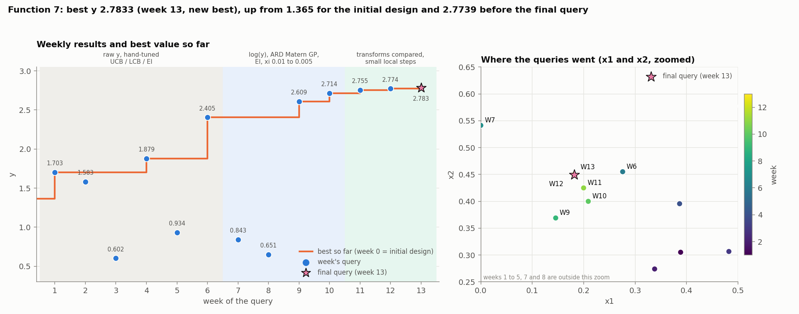
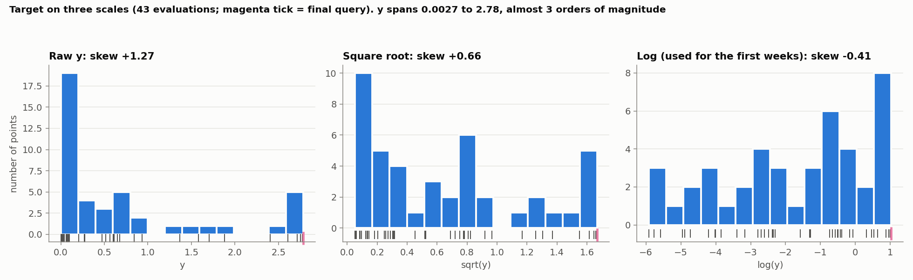
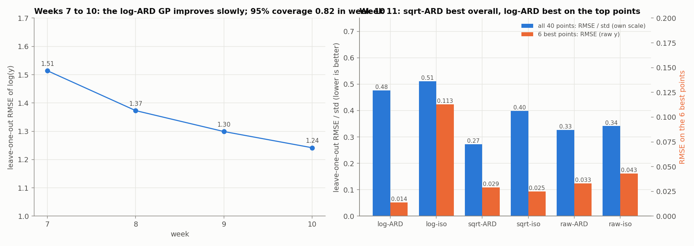
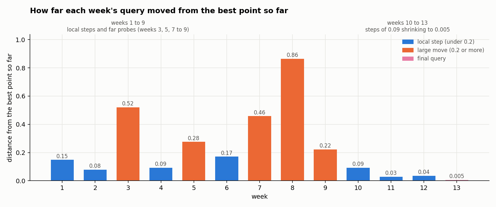
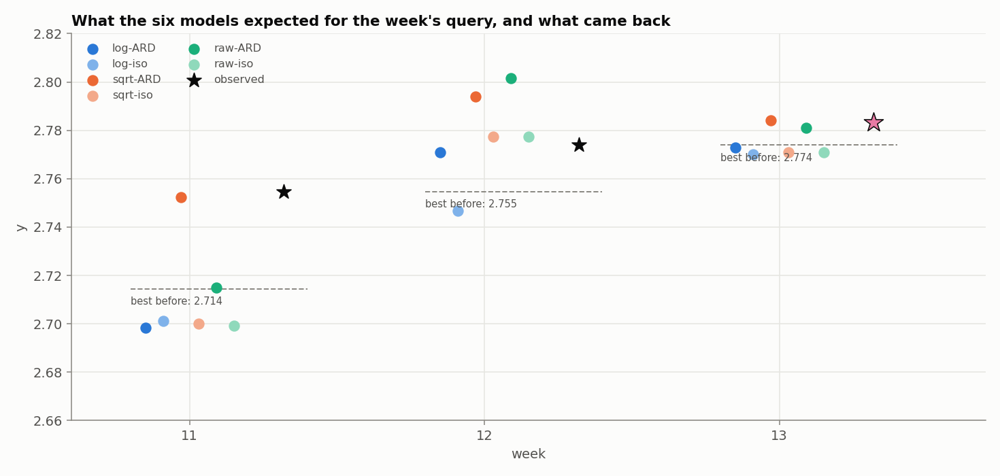

# Function 7: How the strategy evolved

Black-box optimisation, Function 7 (6 inputs, named x0 to x5 in the notebooks, in [0, 1]; maximise). The report covers the strategy each week, what changed and why, and the final query. Facts (numbers, queries, outputs) come from the weekly notebooks and data and from the final query's result. Weeks 7 to 13 are reproducible (fixed seed). Weeks 1 to 6 are not.

The week-13 query is taken to be candidate E of the week-13 analysis, (0, 0.181309, 0.449532, 0.295117, 0.328072, 0.628404): the point that maximises the mean predicted gain over the six models within ±0.05 of the best point. Its result, 2.78330946, comes from the final results file.

## Progress through the rounds

*Figure 1. Left: each weekly result and the best value so far; shading is the modelling regime. Right: where the queries went in x1 and x2, zoomed on the final region; the star is the final query.*

The best of the 30 initial points was 1.365. It rose in eight steps: 1.703 (week 1), 1.879 (week 4), 2.405 (week 6), 2.609 (week 9), 2.714 (week 10), 2.755 (week 11), 2.774 (week 12) and **2.7833 (week 13)**, the final query. The steps shrink: the last four are +0.105, +0.040, +0.019 and +0.009. The final result is **2.7833**, at (0, 0.181309, 0.449532, 0.295117, 0.328072, 0.628404).

## 1. What Function 7 looks like

Function 7 has six inputs. The output is positive and spans almost three orders of magnitude: most points are near zero and a few are large. The good region is small, and all the best points have x0 = 0, on the boundary of the domain, with the other inputs in narrow ranges.

The function is effectively **noise-free**, so small gains are real differences, not noise. The model finds x4 the most sensitive input and x0 the least.

## 2. Timeline

| Week | Target and surrogate | Acquisition | Query | Result |
|---|---|---|---|---|
| 1 to 6 | raw y; RBF ARD, then isotropic Matérn GP [1]; no noise term; no seed | UCB, LCB, EI [2], hand-tuned | a region near (0 to 0.02, 0.28 to 0.39, 0.27 to 0.46, 0.12 to 0.27, 0.35 to 0.39, 0.71 to 0.76) | 1.703, 1.583, 0.602, 1.879, 0.934, 2.405 |
| 7 | **log(y)** [3]; ARD Matérn 5/2 + noise term | EI, xi 0.01 | (0, 0, 0.541, 0.390, 0.208, 0.992) | 0.843 |
| 8 | same | EI | (0, 0.487, 1, 0.684, 0, 1) | 0.651 |
| 9 | same | EI | (0, 0.146, 0.369, 0.327, 0.295, 0.597) | **2.609** |
| 10 | same; Sobol optimiser | EI, xi 0.005, plus an exploitation and a sqrt cross-check | (0, 0.209, 0.400, 0.312, 0.326, 0.644) | **2.714** |
| 11 | log, sqrt and raw compared | quarter-step towards the sqrt-ARD maximum | (0, 0.200, 0.425, 0.305, 0.327, 0.641) | **2.755** |
| 12 | six models | ensemble-mean maximum | (0, 0.183, 0.448, 0.294, 0.331, 0.625) | **2.774** |
| 13 | six models | ensemble-mean maximum | (0, 0.181, 0.450, 0.295, 0.328, 0.628) | **2.783** |

Weeks 1 to 6 were learning rounds: RBF with a length-scale per input in weeks 1 to 3, an isotropic Matérn kernel in weeks 4 to 6, no noise term, and acquisition settings varied by hand. Week 1 already reached 1.703, and week 6 (0, 0.276, 0.455, 0.271, 0.389, 0.710) reached 2.405, the region the later weeks refined.

## 3. Target transformation: log first, then three scales compared

The week-7 notebook models `g = log(y)`: y is strictly positive, spans almost three orders of magnitude, and is heavily right-skewed. A Shapiro-Wilk test [4] supports it (raw y W = 0.726, p < 0.0001; log(y) W = 0.949, p = 0.10; later weeks p = 0.07, 0.05 and 0.04). The log is monotone, so the maximiser is unchanged, and `normalize_y` standardises it for the GP.

*Figure 2. The target on the raw, square-root and log scales (43 evaluations; the magenta tick is the final query).*

In week 11 the choice was tested rather than assumed, with three transforms by two kernels. The skews were +1.59 (raw), +0.78 (sqrt) and -0.37 (log). The leave-one-out results (Figure 3, right):

| Model | RMSE/std (own scale) | Spearman | RMSE on the 6 best points |
|---|---|---|---|
| log-ARD | 0.476 | 0.887 | **0.014** |
| log-isotropic | 0.511 | 0.884 | 0.113 |
| **sqrt-ARD** | **0.272** | **0.924** | 0.029 |
| sqrt-isotropic | 0.399 | 0.867 | 0.025 |
| raw-ARD | 0.327 | 0.713 | 0.033 |
| raw-isotropic | 0.341 | 0.766 | 0.043 |

The sqrt scale was best overall and the log scale best on the points that matter. Neither dominated, so from week 11 the choice became an ensemble of all six models rather than a single transform. The raw-ARD fit also pushed two length-scales to the bound of 100, a sign the raw scale is a poor description.

*Figure 3. Left: leave-one-out error of the log-ARD GP, weeks 7 to 10. Right: the six models of week 11.*

## 4. What changed and why

The strategy moved from exploration to exploitation. Weeks 1 to 9 mixed local steps with far probes (weeks 3, 5 and 7 to 9, up to 0.86 from the best point). From week 10 the steps shrank from 0.09 to 0.005, and the last queries only refined the best point.

*Figure 4. Distance of each week's query from the best point so far. Weeks 1 to 9 include large moves (0.2 to 0.9); from week 10 every step is 0.09 or less.*

| Weeks | What the strategy did | Why |
|---|---|---|
| 1 to 6 | Hand-tuned UCB, LCB and EI. Week 6 reached 2.405 near (0, 0.28, 0.46, 0.27, 0.39, 0.71). | Learning rounds. They found the region that later weeks refined. |
| 7 to 8 | Log target, ARD Matérn GP with a noise term, EI. Both queries were exploratory and returned 0.843 and 0.651, below the best. | The log suits a positive target with a wide range; EI favoured uncertain points, 0.46 and 0.87 from the best. |
| 9 | EI proposed a point 0.22 from the best, which returned **2.609**, a new best. | The model had learned enough to point at the right region. |
| 10 | Lower exploration setting (xi 0.005), a Sobol optimiser, and a sqrt cross-check. Result **2.714**. | To exploit the region found. The log-ARD model was over-confident: its 95% intervals covered only 82% of the points. |
| 11 | Compared three transforms and two kernels, then took a quarter-step towards the sqrt-ARD maximum. Result **2.755**. | Neither the sqrt nor the log scale dominated, so no single transform was trusted. |
| 12 to 13 | Used all six models, picking the point with the highest mean predicted gain within ±0.05 of the best. Results **2.774** and **2.783**. | The models disagreed far from the best point but agreed near it, so small local steps were safe. |

The late gains were small and shrinking (+0.040, +0.019, +0.009). The best point is probably near a local maximum.

## 5. The final query

*Figure 5. The six models' predictions for the queries of weeks 11 to 13 (dots), the value returned (stars), and the best value before each query (dashed).*

The final query returned **2.7833**, a new best (+0.0094), against model predictions of 2.770 to 2.784. The final result is **2.7833**.

## 6. Limitations

- **The gains have flattened** (+0.040, +0.019, +0.009 over the last three queries), which suggests the best point is near the local maximum, but a gain of 0.01 cannot be separated from the models' own errors of 0.01 to 0.03.
- **All best points have x0 = 0**, on the boundary, while the GP says x0 matters least (length-scale 1.5 to 1.8). The one early query with x0 = 0.47 (week 3, 0.602) also differed in x5, so x0 was not tested on its own.
- **Only global surrogates were used.** Local models of the neighbourhood, as in some other functions, might have resolved gains this small better; the six global models agree on direction but not on step size.

## References

1. Rasmussen, C. E. & Williams, C. K. I. (2006). *Gaussian Processes for Machine Learning*. MIT Press. (Gaussian-process regression, ARD and noise kernels, leave-one-out validation.)
2. Jones, D. R., Schonlau, M. & Welch, W. J. (1998). Efficient global optimization of expensive black-box functions. *Journal of Global Optimization*, 13, 455–492. (Expected improvement.)
3. Box, G. E. P. & Cox, D. R. (1964). An analysis of transformations. *Journal of the Royal Statistical Society B*, 26, 211–252. (Variance-stabilising transformations.)
4. Shapiro, S. S. & Wilk, M. B. (1965). An analysis of variance test for normality. *Biometrika*, 52, 591–611.
